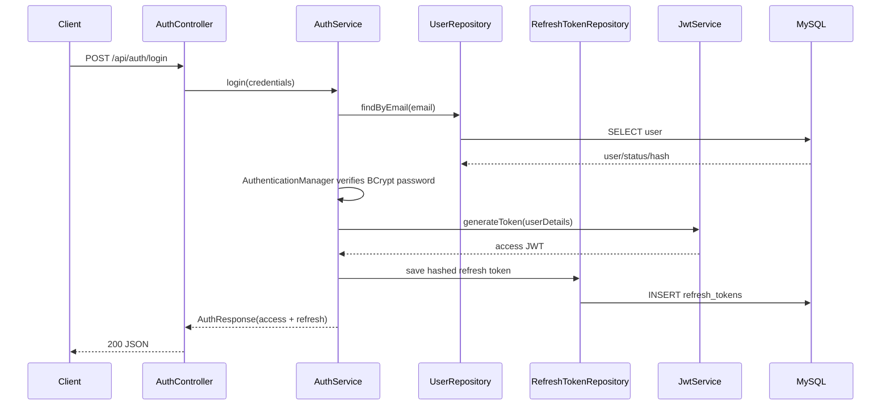

# Authentication Sequence

Refresh-token rotation revokes the consumed token under a transaction and creates a replacement. Logout revokes the supplied refresh token; it does not require an access token in the current API contract.
