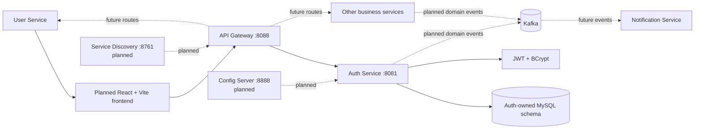

# System Context Diagram

Only Auth Service and API Gateway currently contain implemented runtime behavior. Other service boxes, Kafka, Service Discovery, Config Server, and the frontend represent planned work or buildable project shells.
